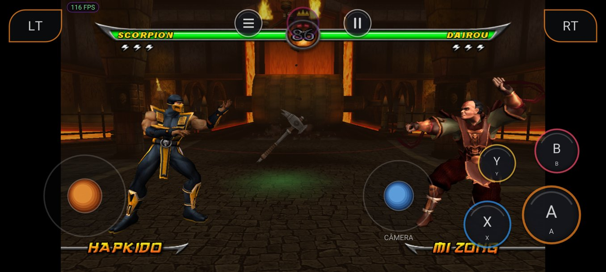

# 🐉 Mortal Kombat: Armageddon — Port Nativo

**O Mortal Kombat: Armageddon de Xbox original rodando nativamente no Android (ARM64), sem emulador de CPU.**

[Sobre](#-sobre) · [Download](#%EF%B8%8F-download) · [Requisitos](#-requisitos) · [Versão do jogo](#-versão-do-jogo-obrigatória) · [Instalação](#-instalação) · [Controles](#-controles) · [Perguntas](#-perguntas-frequentes)

---

## 📖 Sobre

Este port **não é um emulador de Xbox**. O executável do jogo (`default.xbe`, código x86 do Xbox original) é **recompilado estaticamente** para ARM64: o resultado é código nativo, que roda direto no processador do celular. O Direct3D 8 e o DirectSound do Xbox são reimplementados por cima de **Vulkan** e **SDL3**.

> [!IMPORTANT]
> **Você precisa da sua própria cópia do jogo**, na versão indicada em [Versão do jogo](#-versão-do-jogo-obrigatória). O APK não traz os arquivos do jogo; só um trecho curto do vídeo de demonstração do próprio jogo, usado como trailer no menu inicial.

> [!WARNING]
> **Versão alpha (testes).** O jogo vai da abertura ao menu e joga lutas no modo Arcade, mas ainda pode travar, ter falhas de imagem ou de som. Konquest, Motor Kombat, Krypt, Kreate a Fighter e o save ainda não foram testados. Relate problemas nas *Issues*.

## ✨ O que o port oferece

- Recompilação estática do jogo para **ARM64**, sem interpretador de CPU.
- Menu inicial no tema do Mortal Kombat, com o **trailer** do jogo, escolha da **pasta do jogo** e as opções gráficas.
- **Resolução**, **antisserrilhado**, formato de **tela** e **filtro de texturas**.
- **Controles na tela** de jogo de luta: direcional fixo, os quatro ataques em losango, defesa, troca de estilo, arma e agarrão, pausa e voltar.
- Suporte a **controle físico**: os botões da tela somem quando o controle é usado.
- Painel no jogo (emblema do Shadow): gráficos, desempenho, tela, controles e **sair do jogo**.
- **Atualização pelo próprio app**: ao abrir, o menu avisa quando há versão nova aqui nas Releases, baixa e instala (saves e configurações continuam).

## ⬇️ Download

O APK está na página de **[Releases](../../releases)**. Ele é de testes: veja as notas de cada versão.

## 📱 Requisitos

| | Mínimo | Recomendado |
|---|---|---|
| **Android** | 11 (API 30) | 13 ou mais novo |
| **Processador** | ARM64 (arm64-v8a) | Snapdragon 7 Gen 1 / Dimensity 8000 ou superior |
| **GPU** | Vulkan 1.1 | Mali-G710 / Adreno 730 ou superior |
| **RAM** | 4 GB | 6 GB ou mais |
| **Espaço** | uns 4,6 GB para os arquivos do jogo | — |

## 💿 Versão do jogo (obrigatória)

O port é feito para **um executável específico**: o `default.xbe` do **Mortal Kombat: Armageddon de Xbox original, versão americana (USA)**. O código é recompilado a partir dele, então o arquivo precisa ser **idêntico** (confira o hash).

| Campo | Valor |
|---|---|
| Jogo | Mortal Kombat: Armageddon (Xbox original), USA |
| Title ID | `4D570034` |
| Tipo | retail |

| Arquivo | Tamanho | SHA-1 | MD5 |
|---|---|---|---|
| `default.xbe` | 6.033.408 bytes | `24074b8f58a0c10f2dee6862be3ebd267ac1e164` | `3bc9e87625341ee90f771884864f5407` |

<b>Como conferir o hash</b>

- **Windows (PowerShell):** `Get-FileHash default.xbe -Algorithm SHA1`
- **Linux / macOS:** `sha1sum default.xbe`
- **Android:** qualquer app de "hash checker" da Play Store.

## 📲 Instalação

1. Instale o APK.
2. Copie os arquivos do disco (o `default.xbe` e as pastas ao lado dele) para uma pasta do celular, por exemplo `Armazenamento/MKARMAGEDDON`.
3. Abra o app, toque em **ESCOLHER PASTA** e escolha essa pasta (dê a permissão de acesso aos arquivos quando ele pedir).
4. Ajuste as opções e toque em **JOGAR**.

## 🎮 Controles

| Botão na tela | Controle do Xbox | Ação |
|---|---|---|
| Direcional | analógico esquerdo / direcional | andar, pular, agachar |
| 1 SOCO | X | ataque 1 |
| 2 GANCHO | Y | ataque 2 |
| 3 CHUTE | A | ataque 3 |
| 4 ARREMESSO | B | ataque 4 |
| DEFESA | RT | defender |
| ESTILO | LT | trocar de estilo de luta |
| ARMA | branco | sacar a arma |
| AGARRÃO | preto | agarrar |
| ⏸ / ↩ | Start / Back | pausa e voltar |

## ❓ Perguntas frequentes

<b>Funciona com o Armageddon de PS2, Wii ou com outra versão de Xbox?</b>

Não. Só com o `default.xbe` com o hash da tabela. Outro executável é outro programa e precisaria ser recompilado.

<b>O código-fonte está disponível?</b>

Não. Este repositório traz a documentação e o APK de testes. Os componentes de código aberto usados estão listados abaixo, com as respectivas licenças.

## 🙏 Créditos

Este projeto só foi possível graças a estes projetos de código aberto:

- [**XboxXBE-Recomp**](https://github.com/TGP482/XboxXBE-Recomp), por TGP482: recompilador de Xbox original e runtime portátil (D3D8, DirectSound, kernel)
- [**DW5-XBERecomp**](https://github.com/datfooldive/DW5-XBERecomp-Linux), por datfooldive: o port de Dynasty Warriors 5 que serviu de base para o código de Android
- [**SDL 3**](https://github.com/libsdl-org/SDL), [**Dear ImGui**](https://github.com/ocornut/imgui), [**toml++**](https://github.com/marzer/tomlplusplus), [**glslang**](https://github.com/KhronosGroup/glslang), [**Vulkan Memory Allocator**](https://github.com/GPUOpen-LibrariesAndSDKs/VulkanMemoryAllocator) e [**Zydis**](https://github.com/zyantific/zydis)

As licenças completas estão em [THIRD_PARTY_NOTICES.md](THIRD_PARTY_NOTICES.md).

## ⚖️ Aviso legal

Este é um projeto de fãs, **sem fins lucrativos**, sem nenhuma ligação com a Warner Bros. Games, a NetherRealm Studios, a Midway ou a Microsoft. *Mortal Kombat* e *Mortal Kombat: Armageddon* são marcas e obras de seus respectivos donos.

É preciso ter a sua própria cópia original do jogo. Não peça nem compartilhe arquivos do jogo nas issues.

---

Feito com 🧡 por <a href="https://www.youtube.com/@Ll_Shadowll">SHADOWll</a>

